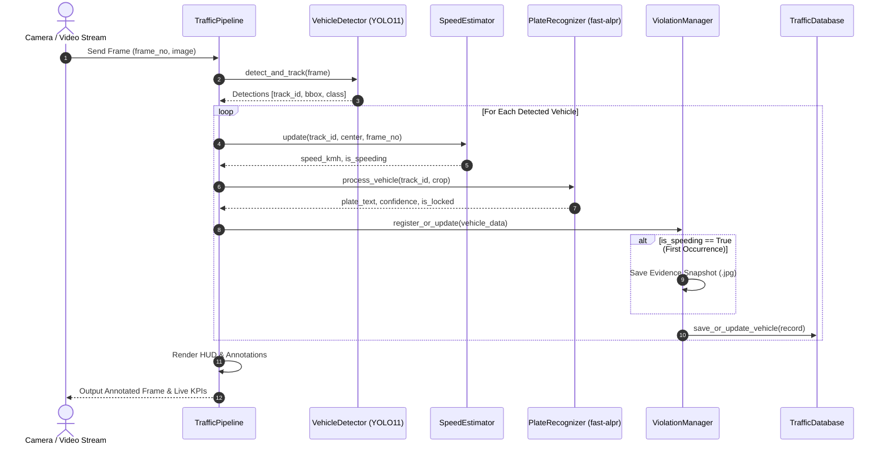

# System Requirements & Architecture Specification
**SEN499 Graduation Project · ISO/IEC/IEEE 29148 Standard Compliant**  
**Project:** SMART TRAFFIC PRO — Speed Estimation & ALPR

---

## 1. System Overview & Scope
The system is an end-to-end automated intelligent transportation system (ITS) pipeline designed to process high-resolution video streams from roadside cameras to perform simultaneous multi-class vehicle detection, continuous multi-object tracking (MOT), frame-timeline speed estimation, automatic license plate recognition (ALPR), and automated photographic violation evidence logging.

---

## 2. Requirements

> The functional and non-functional requirements are maintained **only in the RSA document**
> (Requirements Specification and Analysis, accepted version). It is the authoritative source for
> FR/NFR numbering, MoSCoW priorities, status relative to `v0-baseline` and measurable targets.
> An earlier requirements list in this file was removed because it conflicted with the RSA
> (e.g. it referred to UFPR-ALPR and to the retired Flask web panel).

Key points, consistent with the RSA:

- **Single user interface:** the Streamlit dashboard (`app.py`).
- **Target plate format:** Turkish plates (province code 01–81). UFPR-ALPR (Brazilian plates) is not used.
- **Inference on CPU;** GPU (Google Colab) is used only for fine-tuning YOLO11m on UA-DETRAC.
- **No results are claimed** until `scripts/eval_speed.py` and `scripts/eval_alpr.py` have produced them.

---

## 3. Software Architecture & UML Diagrams

### 3.1 Layered Architecture Overview
```
┌────────────────────────────────────────────────────────┐
│             Presentation Layer (UI / CLI)              │
│       Streamlit Dashboard (app.py) | CLI (main.py)     │
└──────────────────────────┬─────────────────────────────┘
                           │
┌──────────────────────────▼─────────────────────────────┐
│                 Pipeline Orchestration                 │
│                 TrafficPipeline (src/)                 │
└───────┬──────────────┬──────────────┬───────────┬──────┘
        │              │              │           │
┌───────▼──────┐┌──────▼──────┐┌──────▼─────┐┌────▼──────┐
│   Detector   ││    Speed    ││   Plate    ││Violation  │
│   (YOLO11)   ││  Estimator  ││ Recognizer ││  Manager  │
└──────────────┘└─────────────┘└────────────┘└────┬──────┘
                                                  │
┌─────────────────────────────────────────────────▼──────┐
│           Data Persistence Layer (SQLite & CSV)        │
│          TrafficDatabase (output/traffic.db)           │
└────────────────────────────────────────────────────────┘
```

### 3.2 Sequence Diagram: Vehicle Transit & Violation Capture

