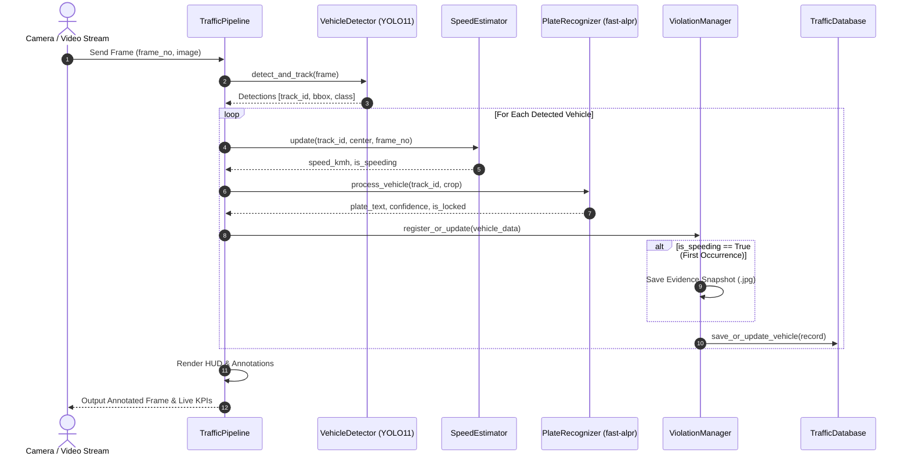

# System Requirements & Architecture Specification
**SEN499 Graduation Project · ISO/IEC/IEEE 29148 Standard Compliant**  
**Project:** AI-Powered Traffic Surveillance: Speed Estimation & ALPR

---

## 1. System Overview & Scope
The system is an end-to-end automated intelligent transportation system (ITS) pipeline designed to process high-resolution video streams from roadside cameras to perform simultaneous multi-class vehicle detection, continuous multi-object tracking (MOT), frame-timeline speed estimation, automatic license plate recognition (ALPR), and automated photographic violation evidence logging.

---

## 2. Functional Requirements (MoSCoW Prioritized)

### Must Have (M)
- **FR-1 (Vehicle Detection):** The system MUST detect vehicles (cars, buses, trucks, motorcycles) in each frame with a confidence threshold $\ge 0.40$ using YOLO11m.
- **FR-2 (Temporal Object Tracking):** The system MUST maintain a unique, persistent `track_id` for every vehicle as long as it remains within the camera field of view using BoT-SORT.
- **FR-3 (Zone-Based Speed Calculation):** The system MUST compute vehicle speed by tracking transit times between user-defined entrance and exit polygons using the video frame rate:
  $$\Delta t = \frac{\text{Frame}_{\text{exit}} - \text{Frame}_{\text{entry}}}{\text{Video FPS}}, \quad v = \left(\frac{d_{\text{real}}}{\Delta t}\right) \times 3.6 \times \left(\frac{\Delta y_{\text{measured}}}{\Delta y_{\text{calib}}}\right)$$
- **FR-4 (License Plate OCR):** The system MUST crop detected vehicle regions within the designated ALPR zone and extract alphanumeric characters using fast-alpr (YOLOv9-t + CCT-S-v2).
- **FR-5 (Confidence Locking):** The system MUST accumulate candidate plate readings and lock the highest-confidence valid candidate once $N \ge 3$ consistent reads are achieved.
- **FR-6 (Speeding Enforcement & Snapshots):** The system MUST automatically trigger an alert and save an annotated high-resolution JPEG snapshot when a vehicle exceeds the configured speed limit.
- **FR-7 (Persistent Relational Storage):** The system MUST store all vehicle records, speed readings, plates, timestamps, and snapshot filepaths into an SQLite database (`output/traffic_surveillance.db`).

### Should Have (S)
- **FR-8 (Interactive Web Dashboard):** The system SHOULD provide a responsive web interface (Streamlit and Flask/HTML5 SOC) for video upload, real-time KPI metrics, and database querying.
- **FR-9 (Multi-Resolution Auto-Scaling):** The system SHOULD automatically scale bounding boxes, HUD text, and polygon coordinates across 720p, 1080p, 2K, and 4K resolutions.
- **FR-10 (CSV / Database Export):** The system SHOULD enable single-click export of surveillance logs to CSV and SQLite database formats.
- **FR-11 (Manual Plate Correction):** The system SHOULD allow operators to audit and manually correct misread license plates via REST API (`PATCH /api/records/<id>/plate`) and UI.

### Could Have (C)
- **FR-12 (Interactive Zone Calibrator):** The system COULD provide a mouse-driven GUI tool to define custom polygon lane coordinates for new camera angles.
- **FR-13 (Country-Specific Plate Validation):** The system COULD enforce strict Turkish (e.g., `34ABC123`) or European standard alphanumeric regex formats.

---

## 3. Non-Functional Requirements (Measurable NFRs)
- **NFR-1 (Hardware Independence & CPU Execution):** The pipeline MUST run entirely on standard CPU hardware without GPU requirement (achieving $\ge 20$ FPS on modern multi-core CPU), supporting GPU/NVENC strictly as an optional performance accelerator.
- **NFR-2 (Speed Measurement Accuracy):** Speed estimation error MUST achieve a Mean Absolute Error $\text{MAE} \le 2.5\text{ km/h}$ compared against ground-truth radar baselines on the BrnoCompSpeed dataset.
- **NFR-3 (Plate OCR Recognition Accuracy):** License plate character recognition accuracy MUST be $\ge 90\%$ for unoccluded, legible plates on standardized test benchmarks (UFPR-ALPR).
- **NFR-4 (Database ACID Compliance):** All persistent transactions in SQLite MUST adhere to ACID guarantees with zero data corruption on abnormal shutdown.
- **NFR-5 (Test Code Coverage):** The business logic layer (`src/`) MUST maintain $\ge 60\%$ automated unit and integration test coverage in CI (GitHub Actions).
- **NFR-6 (Privacy & Anonymization - KVKK/GDPR):** The system MUST automatically blur plates and cabin windows for non-violating vehicles in field recordings, and enforce a 7-day maximum retention policy for raw video footage.

---

## 4. Software Architecture & UML Diagrams

### 4.1 Layered Architecture Overview
```
┌────────────────────────────────────────────────────────┐
│             Presentation Layer (UI / CLI)              │
│       Streamlit Dashboard (app.py) | CLI (main.py)     │
└──────────────────────────┬─────────────────────────────┘
                           │
┌──────────────────────────▼─────────────────────────────┐
│                 Pipeline Orchestration                 │
│                 TrafficPipeline (src/)                 │
└───────┬──────────────┬──────────────┬───────────┬──────┘
        │              │              │           │
┌───────▼──────┐┌──────▼──────┐┌──────▼─────┐┌────▼──────┐
│   Detector   ││    Speed    ││   Plate    ││Violation  │
│   (YOLO11)   ││  Estimator  ││ Recognizer ││  Manager  │
└──────────────┘└─────────────┘└────────────┘└────┬──────┘
                                                  │
┌─────────────────────────────────────────────────▼──────┐
│           Data Persistence Layer (SQLite & CSV)        │
│          TrafficDatabase (output/traffic.db)           │
└────────────────────────────────────────────────────────┘
```

### 4.2 Sequence Diagram: Vehicle Transit & Violation Capture

